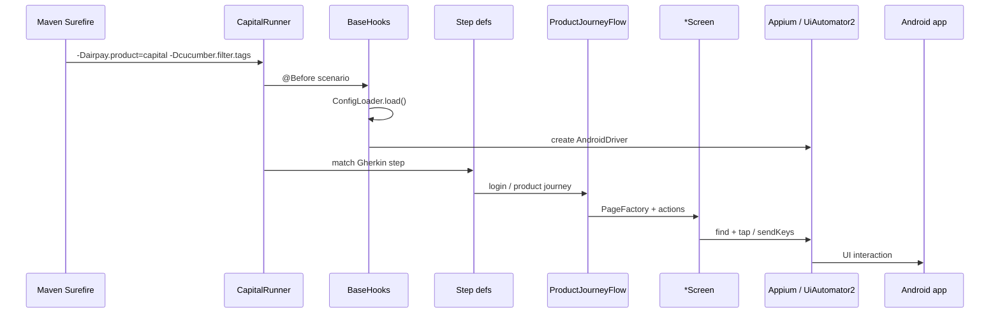

# Airpay Mobile Automation — Architecture

Mobile counterpart of `airpay_automation_gitlab` (Playwright web monorepo). Same layout: shared `utilities`, one Maven module per app, central `config/`, product-scoped `target/<product>/`.

## Repository tree

```
airpay-mobile-automation/
├── config/                       ← defaults + <product>.properties + secrets
├── target/<product>/             ← logs, screenshots, allure-results, a11y
├── utilities/                    ← Appium driver, hooks, config, a11y scanner
├── airpay_capital/               ← first Android app (more apps: airpay_<name>/)
├── airpay_money/                 ← airpay money (com.finmapp.fininfinity)
├── apps/<product>/               ← APK binaries (gitignored)
├── scripts/<product>/run.bat     ← local runner (Appium must be running)
├── jenkins/<product>/Jenkinsfile
└── docs/
```

## Module layout (`airpay_money`)

```
airpay_money/src/test/java/com/airpay/money/
├── screens/          locators on the *Screen class (@AndroidFindBy)
│   ├── auth/         Welcome, Login, OTP, PIN, Biometric, AccountSetup
│   ├── home/         HomeScreen
│   ├── profile/      ProfileHub, ProfileDetails, ProfileWebMenu
│   ├── calculators/  CalculatorsHub, CalculatorScreen
│   ├── finsight/     FinSight + diagnosis screens
│   ├── product/      MF / NPS / FD landing + KYC
│   └── menu/         hamburger / legal
├── flows/  steps/  data/  runner/
```

## Module layout (`airpay_capital`)

```
airpay_capital/src/test/
├── java/com/airpay/capital/
│   ├── screens/          @AndroidFindBy + @iOSXCUITFindBy (PageFactory)
│   │   ├── auth/         Welcome, MobileLogin, Otp, Biometric
│   │   ├── home/         Home, Profile, Notifications
│   │   ├── apply/        Occupation, ApplyDetails, Income, Eligibility
│   │   ├── product/      Landing + offers per loan/card product
│   │   └── info/         FAQs, Contact, Settings, About (sub-screens)
│   ├── flows/            CapitalLoginFlow, ProductJourneyFlow, CapitalLoginA11yFlow
│   ├── steps/            CapitalFunctionalSteps, CapitalA11ySteps
│   ├── data/             CapitalTestData, ScreenMessages
│   └── runner/CapitalRunner.java
└── resources/features/
    ├── functional/       CAPITAL_001–026
    └── a11y/             login deep scan
```

## Runtime flow



## Config loading

`ConfigLoader` (in `utilities`) loads, in order:

1. `config/defaults.properties`
2. `config/<airpay.product>.properties` (e.g. `capital.properties`)
3. `config/secrets.properties` (gitignored)
4. `config/ci-overrides.properties` (Jenkins)

Output paths are resolved under `target/<product>/` via `ProjectPaths`.

## Adding a new Android app

1. Copy `airpay_capital/` → `airpay_<product>/`
2. Rename package `com.airpay.capital` → `com.airpay.<product>`
3. Add `<module>airpay_<product></module>` to root `pom.xml`
4. Add `config/<product>.properties` (package, APK, test mobiles)
5. Add `scripts/<product>/run.bat` (set `MODULE`, `PRODUCT`, `PRODUCT_TAG`)
6. Copy `jenkins/_template/Jenkinsfile` → `jenkins/<product>/Jenkinsfile`
7. Tag features with `@airpay-<product>`

See [ONBOARDING.md](ONBOARDING.md) for step-by-step.
